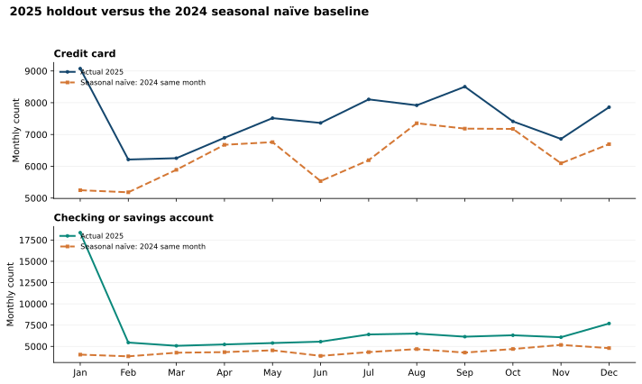

# Consumer Complaint Trends and Forecasting

Harmonize product labels and test a seasonal baseline against 2025 complaint counts.

## Question

How well does a same-month prior-year forecast track changes in published financial-product complaints?

## Approach

Validate a complete 96-month calendar from 2018 through 2025. Combine old and new credit-card product labels, summarize annual counts, and compare each 2025 month with its 2024 counterpart. Report MAE, RMSE, weighted absolute percentage error, and bias.

## Reproduce

From the repository root, using Python 3.12:

```bash
python -m pip install -r requirements.txt
python projects/cfpb-complaint-forecasting/analyze.py
```

The default command uses bundled snapshots, writes `outputs/results.json`, and requires no API key, GPU, or live data service. Shared chart and JSON helpers are in `projects/common.py`.

## Verified results

The 2025 seasonal baseline had 15.5% weighted absolute percentage error for credit cards and 37.3% for checking/savings. Both product series were underforecast in all 12 months. The snapshot covers 96 months.

The saved machine-readable results are in [outputs/results.json](https://github.com/williamesc31/Portfolio/blob/main/projects/cfpb-complaint-forecasting/outputs/results.json). Repository-wide execution evidence and input/code hashes are in [VERIFICATION.json](https://github.com/williamesc31/Portfolio/blob/main/VERIFICATION.json).



## Interpretation and limitations

A reproducible baseline can still underforecast every month. Public complaint counts are not a measure of all customer problems or the number of unique consumers.

## Data and provenance

Recovered CFPB API aggregate snapshot, indexed November 15, 2026. Original query URLs are retained in data/monthly_counts.csv. Source: https://www.consumerfinance.gov/data-research/consumer-complaints/ . Refactored from the saved current-course analysis; no live API calls occur during reproduction.

## Tools

Python · pandas · Time-series validation · Forecast evaluation
