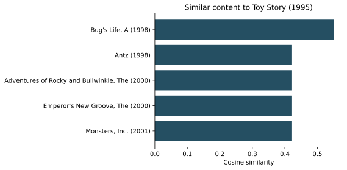

# Movie Discovery with Content Similarity

Recommend movies using TF-IDF representations of genres and user-generated tags.

## Question

Which movies have similar genre and tag content to a selected title?

## Approach

Validate MovieLens movie and tag schemas, aggregate tags by movie, build unigram and bigram TF-IDF features, and rank candidates by cosine similarity. Exclude the query movie and use deterministic ID-based tie-breaking.

## Reproduce

From the repository root, using Python 3.12:

```bash
python -m pip install -r requirements.txt
python projects/movie-recommendations/analyze.py
```

The default command uses bundled snapshots, writes `outputs/results.json`, and requires no API key, GPU, or live data service. Shared chart and JSON helpers are in `projects/common.py`.

## Verified results

The content index covers 9,742 movies and 3,683 tag records. For Toy Story (1995), the highest-ranked recommendation is Bug's Life, A (1998) with cosine similarity 0.550. This is a similarity demonstration, not a held-out accuracy score.

The saved machine-readable results are in [outputs/results.json](https://github.com/williamesc31/Portfolio/blob/main/projects/movie-recommendations/outputs/results.json). Repository-wide execution evidence and input/code hashes are in [VERIFICATION.json](https://github.com/williamesc31/Portfolio/blob/main/VERIFICATION.json).



## Interpretation and limitations

The recovered file called ratings.csv is a tags table. The implementation therefore uses content similarity and does not claim collaborative-filtering performance or predictive recommendation accuracy.

## Data and provenance

GroupLens MovieLens latest-small. https://grouplens.org/datasets/movielens/latest/ . Recovered movies(1).csv and the tags table mislabeled ratings.csv. Data remain under the GroupLens usage conditions linked in data/LICENSE.md. Attribution: Harper, F. M., and Konstan, J. A. (2015), The MovieLens Datasets: History and Context, https://doi.org/10.1145/2827872 .

## Tools

Python · scikit-learn · TF-IDF · Cosine similarity

To query a different movie, pass `--title "Jumanji (1995)"`. The title must exactly match `data/movies.csv.gz`.
