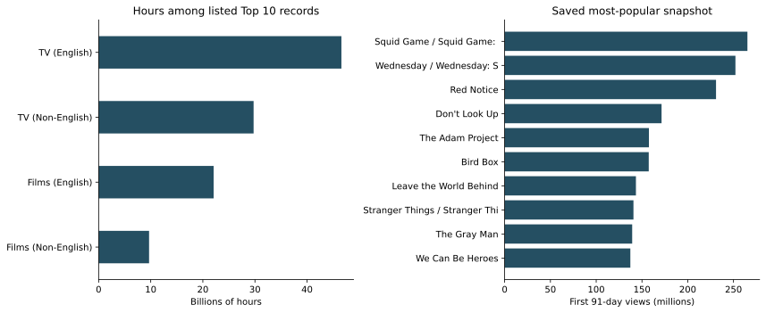

# Netflix Top 10 Engagement Analysis

Separate watch-time, views, and title persistence in a saved Netflix Top 10 snapshot.

## Question

What do the saved Top 10 lists show about category watch-time and the reach of popular titles?

## Approach

Convert the recovered source workbooks to CSV, check rank-key uniqueness, identify title-season combinations, and summarize category hours. Analyze the most-popular first-91-day table separately from weekly records. Dates are derived from the actual files.

## Reproduce

From the repository root, using Python 3.12:

```bash
python -m pip install -r requirements.txt
python projects/netflix-engagement/analyze.py
```

The default command uses bundled snapshots, writes `outputs/results.json`, and requires no API key, GPU, or live data service. Shared chart and JSON helpers are in `projects/common.py`.

## Verified results

The weekly snapshot has 5,840 records and 2,113 title-season combinations, from 2021-07-04 through 2024-04-14. Squid Game leads the saved most-popular table by first-91-day views. Weekly views are available in only 44 weeks.

The saved machine-readable results are in [outputs/results.json](https://github.com/williamesc31/Portfolio/blob/main/projects/netflix-engagement/outputs/results.json). Repository-wide execution evidence and input/code hashes are in [VERIFICATION.json](https://github.com/williamesc31/Portfolio/blob/main/VERIFICATION.json).



## Interpretation and limitations

Top 10 data describe selected titles. They do not cover the entire catalog, and hours, weekly views, and first-91-day views should not be combined as one metric.

## Data and provenance

Netflix Tudum Global Top 10 and Most Popular source workbooks recovered from the earlier data story. https://www.netflix.com/tudum/top10/ . Weekly snapshot coverage is July 2021–April 2024. The published CSVs retain the original workbook records; source hashes are in SOURCE_MANIFEST.json.

## Tools

Python · pandas · Data validation · Visual storytelling
