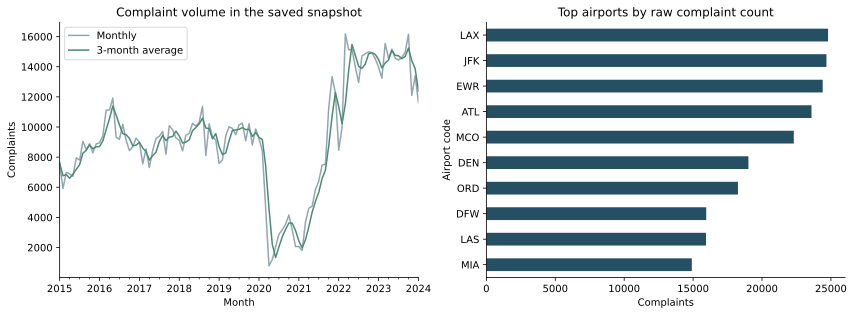

# Airport Complaint Patterns

Explore complaint trends and category concentration while distinguishing volume from service rates.

## Question

Where are complaint counts concentrated, and how do they change over time?

## Approach

Parse monthly airport records, create a three-month moving average, and rank airports by total recorded complaints. Aggregate the recovered category table by month and cleaned category label, then reconcile its total with the airport table.

## Reproduce

From the repository root, using Python 3.12:

```bash
python -m pip install -r requirements.txt
python projects/tsa-complaints/analyze.py
```

The default command uses bundled snapshots, writes `outputs/results.json`, and requires no API key, GPU, or live data service. Shared chart and JSON helpers are in `projects/common.py`.

## Verified results

The airport snapshot records 1,021,281 complaints across 448 airport codes from 2015-01-01 through 2024-01-01. The ten largest airport totals account for 34.9% of the volume. Airport and category totals reconcile.

The saved machine-readable results are in [outputs/results.json](https://github.com/williamesc31/Portfolio/blob/main/projects/tsa-complaints/outputs/results.json). Repository-wide execution evidence and input/code hashes are in [VERIFICATION.json](https://github.com/williamesc31/Portfolio/blob/main/VERIFICATION.json).



## Interpretation and limitations

Complaint counts need passenger-volume denominators before they can support airport service-rate comparisons. Totals can be reconciled without claiming a causal explanation.

## Data and provenance

Recovered complaints-by-airport(1).csv and complaints-by-category(1).csv from the earlier TSA data-story project. Category airport detail is aggregated before publication. Original file hashes and transformation notes are in SOURCE_MANIFEST.json. A definitive original download URL was not retained in the recovered source files.

## Tools

Python · pandas · Aggregation · Service-quality analysis
