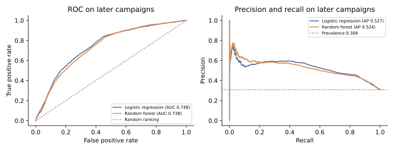

# Bank Marketing Under Distribution Shift

Evaluate campaign targeting with pre-call features and ordered validation and test periods.

## Question

Do campaign models retain useful ranking performance when evaluated on later observations?

## Approach

Use 41,188 ordered UCI bank-marketing contacts. Exclude call duration, split the records 60/20/20 in their supplied order, fit preprocessing on training data, and select a model using validation average precision. Refit on earlier records and evaluate on the last period. Include cumulative gains and a descriptive age-group audit.

## Reproduce

From the repository root, using Python 3.12:

```bash
python -m pip install -r requirements.txt
python projects/bank-marketing-targeting/analyze.py
```

The default command uses bundled snapshots, writes `outputs/results.json`, and requires no API key, GPU, or live data service. Shared chart and JSON helpers are in `projects/common.py`.

## Verified results

Random forest was selected by validation average precision (0.109, versus a 0.111 validation response rate). Its later-period ROC-AUC was 0.738. Selecting the top 20% captured 37.2% of subscriptions in that test period. The weak validation result is a material limitation.

The saved machine-readable results are in [outputs/results.json](outputs/results.json). Repository-wide execution evidence and input/code hashes are in [VERIFICATION.json](../../VERIFICATION.json).



## Interpretation and limitations

The validation period is difficult and response prevalence shifts sharply across periods. The model is not presented as ready for operational deployment or as proof of improved campaign outcomes.

## Data and provenance

UCI Bank Marketing, bank-additional-full.csv. https://archive.ics.uci.edu/dataset/222/bank+marketing . Adapted from the recovered bank-marketing analysis; paths were made project-relative and preprocessing instances isolated per model.

## Tools

Python · scikit-learn · Average precision · Model auditing
