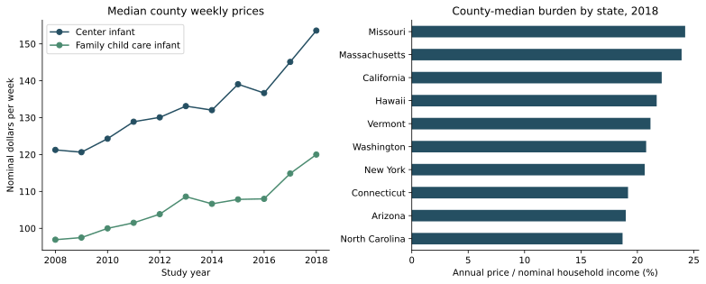

# Childcare Prices and Household Affordability

Connect county childcare prices to household income using a consistent dollar basis.

## Question

How do childcare prices and income burdens vary across counties and states in the saved snapshot?

## Approach

Use the recovered 23,342-row county-year subset. Annualize weekly infant-care prices and divide by nominal household income (MHI). Summarize unweighted county medians by study year and state, then distinguish price levels from affordability burden.

## Reproduce

From the repository root, using Python 3.12:

```bash
python -m pip install -r requirements.txt
python projects/childcare-affordability/analyze.py
```

The default command uses bundled snapshots, writes `outputs/results.json`, and requires no API key, GPU, or live data service. Shared chart and JSON helpers are in `projects/common.py`.

## Verified results

The saved subset contains 23,342 county-year rows covering 2008–2018. In 2018, the median county weekly center-infant price was $153.60; the median annualized-price-to-nominal-income ratio was 16.1%.

The saved machine-readable results are in [outputs/results.json](outputs/results.json). Repository-wide execution evidence and input/code hashes are in [VERIFICATION.json](../../VERIFICATION.json).



## Interpretation and limitations

Mixing nominal prices with an inflation-adjusted income denominator changes the interpretation. County medians also should not be described as population-weighted statewide estimates.

## Data and provenance

U.S. Department of Labor National Database of Childcare Prices, recovered 2008–2018 analysis subset. https://www.dol.gov/agencies/wb/topics/featured-childcare . The subset already excludes counties missing the required care-price measures. Rebuilt from the recovered analysis notebook and CSV with a corrected income denominator.

## Tools

Python · pandas · Data cleaning · Geographic comparisons
