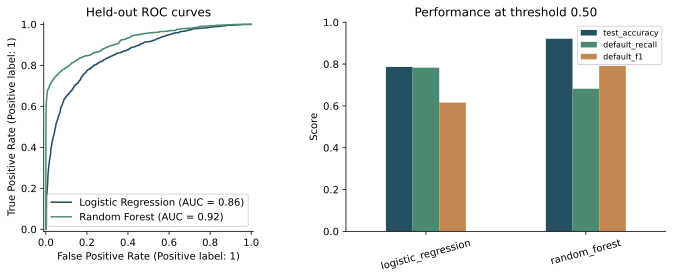

# Credit Risk Default Prediction

Compare classification models while examining the tradeoff between default recall and overall accuracy.

## Question

How well can borrower and loan-pricing information identify default risk in a held-out dataset?

## Approach

Remove exact duplicates and invalid ages, handle impossible employment lengths, and engineer income and employment ratios. Fit imputation, scaling, and one-hot encoding only on the training partition. Compare logistic regression and a fixed Random Forest on a stratified 80/20 holdout.

## Reproduce

From the repository root, using Python 3.12:

```bash
python -m pip install -r requirements.txt
python projects/credit-risk-prediction/analyze.py
```

The default command uses bundled snapshots, writes `outputs/results.json`, and requires no API key, GPU, or live data service. Shared chart and JSON helpers are in `projects/common.py`.

## Verified results

On 6,483 held-out records, Random Forest achieved 92.1% accuracy, 0.920 ROC-AUC, and 68.2% default recall. Logistic regression achieved 78.6% accuracy and 78.3% default recall. These are fresh portfolio-run results, not the historical figures from an earlier notebook.

The saved machine-readable results are in [outputs/results.json](outputs/results.json). Repository-wide execution evidence and input/code hashes are in [VERIFICATION.json](../../VERIFICATION.json).



## Interpretation and limitations

Higher accuracy does not guarantee better default recall. Loan interest rate is available at the pricing stage, so the prediction point must be stated.

## Data and provenance

Recovered credit_risk_dataset.csv, 32,581 records. This portfolio version was rebuilt and rerun from that CSV; it is not the original saved model. Original dataset attribution: Kaggle Credit Risk Dataset.

## Tools

Python · pandas · scikit-learn · Classification pipelines
