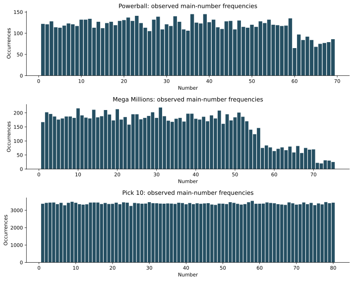

# Lottery Frequencies Without Prediction Claims

Describe historical main-number frequencies and explain why apparent patterns are not forecasts.

## Question

What descriptive patterns appear in the saved draw histories, and what cannot be inferred from them?

## Approach

Parse draw dates and winning-number fields for Powerball, Mega Millions, and Pick 10. Check the expected number of unique main balls in each draw, exclude special balls, and summarize observed frequencies and coverage dates.

## Reproduce

From the repository root, using Python 3.12:

```bash
python -m pip install -r requirements.txt
python projects/lottery-number-analysis/analyze.py
```

The default command uses bundled snapshots, writes `outputs/results.json`, and requires no API key, GPU, or live data service. Shared chart and JSON helpers are in `projects/common.py`.

## Verified results

The snapshot contains 1,617 Powerball draws, 2,285 Mega Millions draws, 13,570 Pick 10 draws. Each draw passes the configured main-ball count and within-draw uniqueness checks. Frequencies are reported without predictive claims.

The saved machine-readable results are in [outputs/results.json](outputs/results.json). Repository-wide execution evidence and input/code hashes are in [VERIFICATION.json](../../VERIFICATION.json).



## Interpretation and limitations

Game rules and eligible number pools changed across these histories. Pooled counts do not establish predictability and are not used as future-draw probability estimates.

## Data and provenance

New York Open Data lottery draw CSVs recovered from the earlier lottery data-story project. https://data.ny.gov/ . The saved filenames identify the April 21, 2024 export. This portfolio script refactors the original notebook into a reproducible descriptive analysis.

## Tools

Python · pandas · Validation · Statistical visualization
