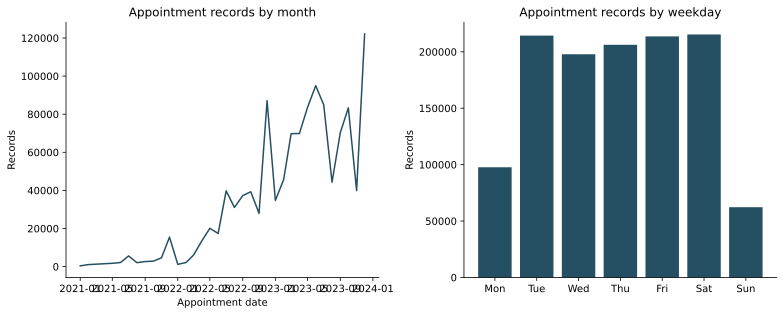

# Public Appointment Log Analysis

Coalesce two log schemas and analyze anonymous appointment aggregates.

## Question

What appointment patterns remain visible after harmonizing the source columns and removing personal identifiers?

## Approach

Stream the recovered 1.2-million-record CSV inside its ZIP. Coalesce matching legacy and display-name date columns rather than renaming them into duplicate labels. Aggregate appointment month, weekday, cancellation indicator, and access type. Publish only aggregate counts.

## Reproduce

From the repository root, using Python 3.12:

```bash
python -m pip install -r requirements.txt
python projects/white-house-visits/analyze.py
```

The default command uses bundled snapshots, writes `outputs/results.json`, and requires no API key, GPU, or live data service. Shared chart and JSON helpers are in `projects/common.py`.

## Verified results

The aggregate snapshot accounts for 1,207,458 appointment records from 2021-01 through 2023-12, using 340 aggregate rows. No individual visitor names or identifiers are published.

The saved machine-readable results are in [outputs/results.json](outputs/results.json). Repository-wide execution evidence and input/code hashes are in [VERIFICATION.json](../../VERIFICATION.json).



## Interpretation and limitations

Appointments are not unique visitors or confirmed attendance. Aggregating the source supports reproducible trend analysis while omitting names and identifiers from the repository.

## Data and provenance

Recovered white_house_combined_download.zip from the earlier visitor-log project. The source archive hash and row counts are retained in data/provenance.json. Only anonymous aggregates are published. prepare_snapshot.py can regenerate the aggregate snapshot when the original ZIP is supplied.

## Tools

Python · Chunked CSV loading · Schema repair · Aggregation
